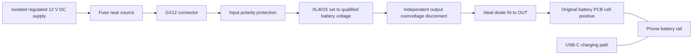

# Reverse-current blockers, GX12 power, and a printed rear cover

[Mona documentation](README.md) · [Sources](../../reference/sources.md) · [USB-C protection and software policy](usb-power.md)

Research date: **2026-10-16**. These are purchasing candidates and a proposed
mechanical layout. No candidate board has been electrically qualified on Mona.
The existing phone measurements were about 4.17 V at the battery rail; that is
an observation, not a complete permissible voltage specification.

## Ranked module types and search terms

This ranking is my engineering judgment for a compact, continuously powered
phone using the XL4015 at roughly 4.2 V. It prioritizes documented reverse-current
blocking, low loss, and usable startup margin. Search terms identify candidates;
they do not establish the authenticity or specifications of a marketplace board.
Use manufacturer documentation and the exact module schematic to check each one.
Use these terms on AliExpress or other suppliers. Named Pololu and Adafruit
boards are documented reference options; a similar-looking board may differ.

The blocker goes between **XL4015 OUT+ and the original battery PCB cell-positive
input**. It must block current from the phone back into the buck while allowing
the buck to power the phone. “Anti-reverse connection” alone is not sufficient.

| Rank | Search terms | Fit for this phone |
| --- | --- | --- |
| **1 — first compact prototype** | `Pololu 5383 ideal diode`, `Pololu 5388 ideal diode`, `LM74700-Q1 ideal diode module 4V reverse current blocking` | Prefer a documented board such as [Pololu #5383](https://www.pololu.com/product/5383): 4 V startup, operation down to 3.2 V afterward, <5 mΩ MOSFET resistance, about 7.6 × 12.7 mm. The larger #5388 is another low-loss option. **Conditional on reliable startup at 4 V.** A generic LM74700 board does not inherit Pololu's specifications. |
| **2 — better low-voltage margin** | `LTC4412 ideal diode module 2.5V external MOSFET`, `LTC4412HV power ORing module` | The [controller operates from 2.5 V](https://www.analog.com/en/products/ltc4412.html) and drives an external P-channel MOSFET. Attractive if a 4 V startup requirement is too close to your minimum voltage. Require the actual MOSFET part number, low-voltage on-resistance, schematic, and board current rating; the controller name alone does not specify amperage. |
| **3 — straightforward lower-voltage breakout** | `LM73100 ideal diode module`, `Adafruit 6359 LM73100` | [LM73100](https://www.ti.com/product/LM7310) provides true reverse-current blocking from 2.7–23 V, with about 28 mΩ typical resistance and a 5.5 A chip rating. [Adafruit's board](https://www.adafruit.com/product/6359) has a 5 A maximum; its [wiring guide](https://learn.adafruit.com/adafruit-lm73100-ideal-diode-breakout/pinouts) specifies input starting at 3 V. More voltage drop and heat than the low-resistance external-MOSFET options; qualify measured peaks and enclosure temperature. |
| **4 — configurable protection option** | `TPS25947 true reverse current blocking eFuse module`, `TPS25947 evaluation board adjustable OVLO` | [TPS25947](https://www.ti.com/product/TPS25947) combines reverse blocking with current and voltage protection: 2.7–23 V, up to 5.5 A, about 28 mΩ typical. Useful if you want those extra controls and can configure them. Check the exact variant, current limit, UVLO, OVLO, and startup ramp; a factory setup for a different rail is unsuitable. |
| **5 — workable, limited voltage margin** | `LTC4359 ideal diode module 4V`, `LTC4359 reverse current blocking MOSFET` | The [controller's operating range starts at 4 V](https://www.analog.com/en/products/ltc4359.html). It can provide low loss with a suitable N-channel MOSFET, but offers little low-voltage margin here. Only consider a documented board whose minimum supply remains within specification during startup and load steps. |
| **6 — bench experiment only** | `XL74610L ideal diode module 1.5-36V` | A useful term for finding inexpensive boards, but I have not verified a manufacturer controller datasheet. Do not accept the advertised voltage/current range without testing the exact board. It is below the documented options for an unattended phone. |

**My starting choice is #5383 if its 4 V startup requirement is met.** If that
cannot be guaranteed over the intended voltage and temperature range, investigate
rank 2 or 3 instead of raising the phone's supply voltage to accommodate a board.
No candidate has been qualified on this phone.

### Specifications to require

The numerical targets below are shopping targets, not measured Mona power
requirements. Measure boot/load peaks before making the final current choice.
UVLO and OVLO mean undervoltage and overvoltage lockout: thresholds that turn
off the power path when the monitored voltage is outside its permitted range.

| Specification | What to require |
| --- | --- |
| **Reverse-current blocking** | Explicit OUT-to-IN blocking while enabled, during startup, and with IN unpowered while OUT is powered. Ask for reverse leakage and turn-off behavior. A polarity protector or back-to-back MOSFET label alone does not establish this function. |
| **Startup and operating voltage** | Both must cover the lowest actual buck output, including wiring loss and transients. A guaranteed startup minimum of **3.3 V or lower** gives more margin; a 4 V board is conditional. Reject a **5 V minimum** board for this rail. Check the module's specification, not just the chip's headline range. |
| **Continuous and peak current** | As an initial shopping filter, seek a documented **5 A continuous board at about 4.2 V**, with thermal conditions stated; a low-loss 10 A-class board can provide useful margin. Actual capacity must exceed measured sustained load and boot/USB peaks inside the cover. The XL4015's 5 A chip rating does not prove the converter board can deliver that continuously. |
| **Voltage drop and heating** | Prefer a total conducting-path resistance around **10 mΩ or less**, specified at the actual gate drive and temperature. At 5 A, 10 mΩ alone contributes 50 mV drop and 0.25 W; 30 mΩ contributes 150 mV and 0.75 W. Measure total drop, including controller regulation, traces, wires, and connectors. |
| **MOSFET and board evidence** | Obtain controller/MOSFET markings, schematic, and thermal/current data. MOSFET threshold voltage is not its fully-on voltage. Check on-resistance at the gate voltage the controller actually supplies near 4.2 V. |
| **Voltage limits and control settings** | IN, OUT, and differential-voltage ratings must cover the intended circuit and fault exposure. Verify enable defaults and any UVLO/OVLO/current-limit settings. For TPS25947, select a suitable adjustable-cutoff variant if needed; its fixed clamp choices are not automatically suitable battery-rail limits. |
| **Physical implementation** | Measure PCB outline, height, pad/terminal current capability, and heat clearance before designing the cover. Use soldered power wiring or rated terminals; do not route the phone supply through breadboard/Dupont connections. |

For integrated devices, the chip limit is a ceiling, not the assembled board's
thermal rating. LM73100's current-monitor output also does not replace an
external bidirectional measurement of current into the buck.

### Terms that need extra caution

- **`LM74700 5-30V` / `12V solar anti-backflow`:** reject the module if its
  documented minimum is above the battery rail. TI specifies a separate startup
  threshold for [LM74700-Q1](https://www.ti.com/product/LM74700-Q1); “3.2 V operation”
  does not mean it starts at 3.2 V.
- **`reverse polarity protection` / `anti-reverse connection`:** may allow
  reverse current after normal startup. Require an explicit reverse-current
  specification. Pololu's similar-looking non-ideal-diode variants do allow it.
- **`LM66100 ideal diode`:** its [1.5 A continuous limit](https://www.ti.com/product/LM66100)
  makes it a poor default for the intended high-performance appliance.
- **`LM74610 zero-IQ ideal diode` / `XL74610L`:** TI's genuine
  [LM74610-Q1](https://www.ti.com/lit/ds/symlink/lm74610-q1.pdf) periodically returns
  to MOSFET body-diode conduction to recharge its gate supply. Those voltage
  dips matter on this low-voltage rail. The XL name does not establish the same
  silicon or behavior; scope its startup, light-load, and sustained-load output.
- **`Schottky diode module`:** a possible bench fallback, but a 0.3 V drop at
  5 A would dissipate 1.5 W. Do not raise the buck's idle voltage to hide the
  load-dependent loss.

### Ask the seller

> Does this exact board block OUT-to-IN current with IN at 0 V and OUT powered,
> and while both sides are powered with OUT higher? What are its guaranteed
> startup minimum, continuous current at 4.2 V, voltage drop, reverse leakage,
> dimensions, and controller/MOSFET part numbers? Please provide the schematic.

Finally, reverse blocking protects the buck. It does **not** absorb charging
energy arriving at the phone side, or protect the phone from a buck failure
that passes its higher input voltage. Those need the separate protections
in the layout below and the [USB power guide](usb-power.md).

## Proposed GX12 layout

The GX12 pin count, contact rating, and external supply are not yet specified.
The following is a **proposed 12 V DC input architecture**, not a pinout for the
connector already owned. Never connect 12 V to the battery PCB or phone rail.

This shows the positive power path and protection functions, not a finished
schematic. The overvoltage disconnect still needs component selection and
threshold/transient qualification. Route the return through the original
cell-negative connection and retain the PCB's protection/sense topology.
Ground-referenced blocker modules connect to the supply/cell-side return as
specified by their manufacturer. Do not bridge a protected or sensed negative
terminal. USB/PC grounds can create an unintended bypass; inspect the complete
ground path because the XL4015 is not isolated.

The ideal diode belongs **after the buck**. Keep the buck's feedback on its own
output and retain its output capacitors. An input-only diode cannot stop
current entering the buck's output. Independent output overvoltage protection
addresses a different fault: a failed buck could expose the phone to its higher
input voltage. A fuse or ideal diode alone does not stop forward overvoltage.

USB charging can still raise the rail on the **phone side** of the ideal diode.
The diagram does not contain that energy: a separately qualified disconnect of
incoming charging power, or an appropriate source/sink battery emulator, is
needed to contain that fault. Do not treat a generic TVS or a 4.2 V zener as a
continuous precision voltage regulator. See [USB protection](usb-power.md).

### Inside or outside the cover?

| Arrangement | Benefit | Cost |
| --- | --- | --- |
| GX12 carries 12 V; XL4015 and blocker inside | Short high-current battery wiring and lower cable current. Fits the integrated appliance concept. | Adds converter heat, switching circuitry, and a higher-voltage supply inside the phone enclosure. |
| XL4015 outside; GX12 carries the qualified battery voltage | Keeps converter heat outside and makes bench servicing easier. | More current through the cable/connector; resistance and startup voltage drop matter much more. |

For scale only: a hypothetical 4.2 V × 5 A load is 21 W. At an assumed 90%
efficiency, a 12 V input would supply about 1.94 A and the converter would
dissipate about 2.33 W. These are **illustrative calculations**, not measured
Mona consumption or measured XL4015 efficiency. Several watts inside the cover
can compete with processor cooling.

I would qualify the circuit outside the phone first, then use a raised,
removable electronics section in the new cover if internal temperatures allow.
The [XL4015 datasheet](https://www.xlsemi.com/datasheet/XL4015-EN.pdf) specifies
8–36 V input; a normal 5 V supply is not an appropriate input for this converter.
Its 5 A chip rating does not qualify a particular cheap module at 5 A in a case.
Keep 12 V and battery-voltage cables mechanically incompatible, or use only
one final connector scheme with clear labels; mixing them could destroy the
phone.

### GX12 wiring and mounting

- Verify the exact connector's drawing, contact rating, and numbered pin view.
  GX12 does not define a universal power pinout. For example, one
  [Renhotec GX12 family](https://renhotec-industrial.com/product/gx12-butt-joint-type-male-plug-threaded-cable-mount-solder-silver)
  lists 5 A for 2–4 contacts and 3 A for 5–7 contacts. Those are not ratings for
  an unidentified connector. Confirm both mating halves and the cable.
- Use a recessed/socket-contact source end so a disconnected powered cable has
  no exposed live pins. Verify continuity from the actual contact numbers;
  mating and solder views can be mirrored. Label voltage and polarity at both
  ends. Leave unused contacts insulated; do not assume paralleling contacts
  increases the rating.
- Use low-voltage DC only. Disconnect power before mating/unmating unless the
  specific connector is rated to switch that load. Size the source fuse for
  the cable and weakest contact, allowing measured startup current; the buck's
  output-current label is not an input fuse specification.
- Reinforce the mount with a boss/backing washer and strain relief. Measure the
  actual cutout, nut, solder cups, and wire bend clearance before CAD; the GX12
  label alone does not define those dimensions. Keep the shell away from live
  pads and do not use it as the power return.

## Printed rear-cover design notes

- **Measure the actual parts first.** Reserve height for the XL4015 inductor,
  capacitors, adjustment control, wiring, and insulation. Provide access to the
  fuse/disconnect and protected test points on both sides of the blocker. Keep
  the USB-C port, stylus, power button, cameras, and service screws accessible.
- **Support boards and wires mechanically.** Use standoffs and an insulating
  barrier under solder joints. Avoid pressure on the retained battery PCB,
  flex cables, or sensor wiring. Adhesive alone is poor strain relief for a
  locking metal connector.
- **Give the converter its own heat path.** Avoid dumping its heat into the
  processor heatsink. Preserve existing shields and thermal interfaces, and
  use electrically insulating thermal interfaces where needed. The XL4015
  package tab is a switching node, not a ground heatsink attachment point;
  check the [pinout](https://www.xlsemi.com/datasheet/XL4015-EN.pdf) before adding
  metal cooling hardware.
- **Leave antenna and coil clearances.** Map antennas, NFC and any wireless
  charging coil before adding metal or locating the buck inductor. Check RF
  performance after assembly. Keep wireless charging disabled/disconnected
  unless its incoming-power path is also qualified.
- **Choose filament using measured temperatures and mounting loads.** PLA can
  serve for a fit prototype. PETG or ASA are candidates for the working cover,
  subject to the particular filament's thermal/creep data; neither name alone
  establishes a flame rating or certified electrical insulation. Prusa's
  [PETG](https://help.prusa3d.com/article/petg_2059) and
  [ASA](https://help.prusa3d.com/article/asa_1809) guides discuss their differing
  heat resistance. Leave thermal margin, especially near inserts and the GX12
  mount. A modified/vented cover should not retain the original water-resistance
  assumption; keep conductive printer debris away from electronics.

## Qualification before enclosing it

Start with the phone disconnected and a current-limited supply/electronic load:

1. Check polarity, cold startup, voltage drop, and temperature over the intended
   input range and measured load peaks. Scope startup, load steps, load removal,
   and extended light-load operation on **both sides** of the blocker. Do not
   raise idle voltage to conceal inadequate wiring or a diode's voltage loss.
2. Use a current-limited bench arrangement to test output-powered/input-off
   behavior and switching between supplies. Measure reverse current with a
   suitable series instrument/shunt; never place an ammeter across the rail.
   Verify any overvoltage disconnect on the bench before connecting the phone.
3. After bench qualification, measure phone-side voltage and reverse current
   during the intended USB roles, source attachment/removal, boot, and shutdown.
   Hardware must remain effective before Magisk starts. Preserve voltage,
   current, temperature, and hardware protection signals.
4. Repeat realistic sustained load and idle tests inside the final cover at the
   expected ambient temperature. Record converter, connector, case, and phone
   temperatures, CPU throttling, network performance, and USB serial reliability.
   Inspect the wiring after thermal cycling before unattended use.

The [userspace charging-inhibit service](usb-power.md#optional-charging-inhibition)
is the additional software layer after electrical qualification. Keep its two
enable/qualification flags off until then. Manual [fake SOC](fake-soc.md) changes
reported capacity; it does not inhibit charging or replace electrical protection.
No automatic fake SOC, thermal bypass, or kernel source change is required for
this hardware plan.
