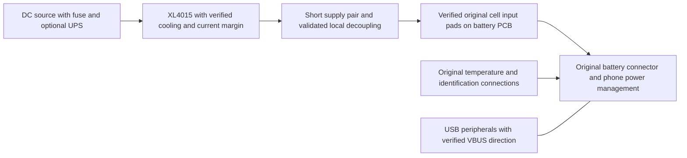

# Mona battery-replacement supply

[Mona index](README.md) · [USB-C protection](usb-power.md) · [Hardware buying guide](hardware.md)

The cell has been removed and its original protection/fuel-gauge PCB retained.
This is a proposed supply design based on the [2026-10-16 observations](validation.md),
not an electrically qualified battery emulator. Start with the stock thermal
and charging protections, and preserve the original sense/identification wiring.

## Power delivery with the XL4015

### Supply architecture

Confirm that the cell is completely removed, identify original cell-side and
phone-side pads, and preserve the protection FET/current-sense path. Do not
bridge around the PCB or guess at extra sense/identification pins. The reported
model includes `LS30_ATL_1255MAH` while design capacity is 4870 mAh; neither that
string nor `battery_parallel_cell_count=0/0` establishes the physical cell
topology. Inspect the original pack markings and connections.

For a confirmed single-series-cell replacement rail, approximately 4.1–4.2 V
at the phone under load is a reasonable engineering starting range; the live
phone currently reads about 4.17 V. This is not an OEM-approved batteryless
specification. Do not raise the voltage to make capacity climb. The reported
`voltage_max=4500000` is a charging parameter, not permission to run an
uncharacterized supply at that limit. Never put USB 5 V directly on this rail.

The [XLSEMI datasheet](https://www.xlsemi.com/datasheet/XL4015-EN.pdf) specifies
8–36 V input and 5 A output capability. A regulated 12 V input is within that
range; ordinary 5 V USB input is not. The chip specification does not establish
the continuous rating of a particular module's inductor, diode, capacitors,
connectors, or cooling. Its typical 7 A switch-current limit is not a usable
7 A module rating or a calibrated adjustable output current limit.

Use a current limit above measured startup/workload peaks, within the verified
ratings of the complete path. A module entering constant-current mode lowers
voltage and can reset the phone. At 4.2 V, 5 A corresponds to 21 W before any
needed design margin. Include USB devices powered by the phone in the budget.
If the measured peaks or temperatures exhaust that margin, replace the supply
with a documented converter with adequate transient capacity or a battery
simulator. Choose from measurements, not an advertised current alone.

### Transients, wiring, and cooling

Measure voltage at the phone connector as well as the buck output. Short,
adequately sized paired leads reduce voltage drop and inductance. For example,
0.1 ohm total resistance drops 0.4 V at 4 A. A multimeter or GLINK sample can
miss the short dip that actually causes a reset.

Scope startup, CPU bursts, Ethernet traffic, USB peripheral startup, and sudden
load removal. Use an appropriate probe/ground connection that does not short
the circuit through an earth-referenced instrument. Check ringing, overshoot,
and converter recovery as well as average voltage. TI describes why
[load-transient testing matters](https://www.ti.com/document-viewer/lit/html/SSZTCT1/GUID-6CD38018-D34C-498A-B48E-24947043FB89).

Local decoupling can help, but choose capacitance/ESR with the module's control
loop and inrush limit in mind. As an idealized lower bound, supplying an extra
2 A for 1 ms with at most 0.2 V droop takes `C = I*dt/dV = 10,000 uF`, even
before ESR and wiring effects. A token capacitor cannot replace the original
cell's energy reserve. This calculation is an illustration, not a capacitor
prescription for an unmeasured module. Large added capacitance can create new
startup problems.

Cool the buck's switching device, diode, and inductor as necessary. The XL4015
metal tab is the switching node, per its datasheet: use electrical isolation
where a heatsink could contact grounded metal. For the phone, couple a heatsink
to a verified heat-spreading surface with an electrically insulating thermal
interface and controlled mechanical pressure. Avoid shorts or force on exposed
packages; a phone package may include stacked memory. Check PMIC/board/USB
temperatures too. Cooling only the processor cannot qualify the power path.

### USB charging and reverse power

See [the USB power guide](usb-power.md) for specific ideal-diode boards,
USB role choices, the live Motorola charging-disable control, and a proposed
hardware/software protection plan. That follow-up found usable software
candidates; their electrical effect remains untested.

Treat simultaneous USB/PD/wireless input as a separate electrical design case.
The XL4015 is not specified as a battery simulator that absorbs charge current.
If the phone charges the replacement rail, an ordinary supply can lose voltage
control or receive reverse current. TI's
[charger evaluation guide](https://www.ti.com/lit/ug/sluuab0a/sluuab0a.pdf)
uses a source/sink battery simulator for this reason; its specific circuit is
not a recommendation for this phone.

Prefer a verified USB arrangement in which the phone is the intended host and
external peripheral power cannot feed its VBUS unexpectedly. Powered hubs and
USB-C PD docks differ. Simply cutting VBUS can also break detection, role
negotiation, or the required host supply. A diode protecting the buck alone
does not clamp a battery rail driven upward by the phone's charger.

Do not rely on a late Magisk command to establish electrical isolation: Android
may not have booted yet, and a crash removes that control. Also, this driver's
`charge_control_en` gates SOC-threshold charge control; it is not established
as a master charger-disable switch.
Validate any vendor charging-inhibit control in source and on the actual
hardware before using it. Avoid generic ACC/charging scripts until their
selected node and effect on USB host mode are understood.

## Capacity and recovery

[Manual fake SOC](fake-soc.md) changes reported capacity after the charger
module is rebuilt. It does not inhibit charging, repair supply transients,
change the firmware gauge, or guarantee recovery after total power loss.
Do not use `dumpsys battery set` as a permanent workaround: it freezes Android's
battery snapshot, including temperature updates. If a previous test used it,
`dumpsys battery reset` restores normal updates.

An upstream UPS can cover input interruptions. Automatic power-on after supply
loss is a separate bootloader/hardware question; Magisk cannot start a powered-off
phone. The observed boot reason was `power_key_press`. Qualify that recovery
path before unattended use. For testing order, see [validation](validation.md).
